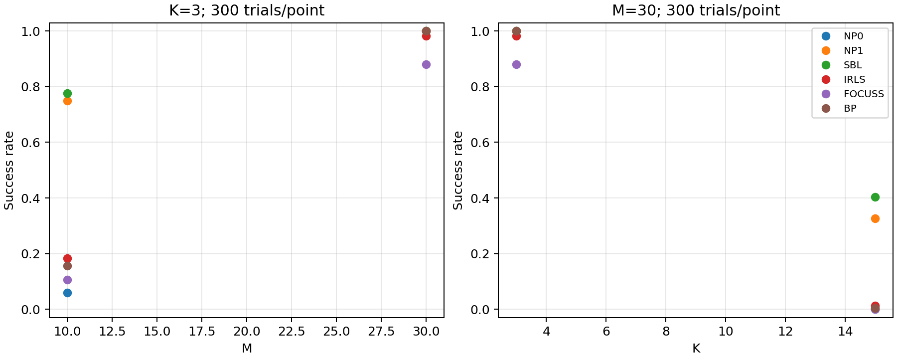
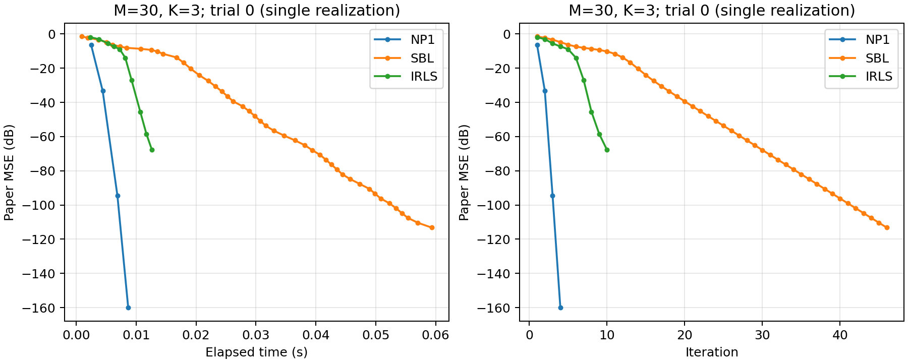

# 组长任务执行摘要

执行日期：2026-10-19。

## 已完成

- 阅读本地原论文并视觉核对核心公式、图注、停止条件及成功判据。
- 完成统一数据生成、6 个参考算法调度、指标计算、逐次结果/轨迹保存、绘图、打包与成员接入规范。
- 8 项测试通过：6 项单元测试覆盖指标、数据可重复性、条件高斯公式、各算法基础恢复、BP 最优解和 SBL 初始化回归；2 项 CLI 测试验证算法异常与结果改动会使验收失败。
- 3 个工况各 300 次，每次 6 算法：每轮 5,400 次调用，两轮合计 10,800 次。
- 两个独立 Python 进程的复跑比较：全部通过。
- 算法源码所属 Git 提交：`466acd653679db5490c904ab418a45afeda9e270`。运行时工作区状态原样保留在 manifest。

## 第一轮实测成功率

| 算法 | M=10,K=3 | M=30,K=3 | M=30,K=15 |
|---|---:|---:|---:|
| NP0 | 6.0% (18/300) | 100.0% (300/300) | 0.0% (0/300) |
| NP1 | 75.0% (225/300) | 100.0% (300/300) | 32.7% (98/300) |
| SBL | 77.7% (233/300) | 100.0% (300/300) | 40.3% (121/300) |
| IRLS | 18.3% (55/300) | 98.3% (295/300) | 1.3% (4/300) |
| FOCUSS | 10.7% (32/300) | 88.0% (264/300) | 0.0% (0/300) |
| BP | 15.7% (47/300) | 100.0% (300/300) | 0.3% (1/300) |

第一轮异常：0；达到迭代上限的调用数：223。达到上限仍统计真实误差，不自动算作成功或异常。

## 可重复性证据

| 检查 | 结果 |
|---|---|
| completed_without_errors | PASS |
| same_config | PASS |
| same_source | PASS |
| same_algorithms | PASS |
| same_environment | PASS |
| output_integrity | PASS |
| same_trials_metrics_and_data | PASS |
| estimates.npz | PASS |
| histories.npz | PASS |

比较排除耗时；估计与迭代轨迹容差 rtol=1e-10、atol=1e-12，逐次指标和数据指纹一致。源码/配置/运行环境均已记录。

## 交付位置

- 使用说明：README.md；算法接入：docs/算法接口.md。
- 论文口径和未公开参数：docs/论文实验口径.md。
- 两轮完整结果：results/validation_a、results/validation_b。
- 复跑结论：results/validation_reproducibility.json。
- 汇总 CSV：results/validation_a/summary.csv；逐次记录：trials.csv。
- 成功率检查图和单样本收敛图：results/validation_a/*.png。
- 框架提交包：dist/leader_submission.zip，包内有文件哈希清单。

## 尚需团队完成

当前没有组员提交的代码，不能完成“所有人代码交叉复跑”的真实验收。需接收核心/基线成员模块，按接口接入后由另一人复跑并填写交付与验收表。理论文档、报告、PPT 和答辩材料也尚未提供。

本次执行的是代表工况 300 次验证；完整 Fig.3 的 59 个工况配置已准备，但尚未执行。Fig.4 图使用 trial=0 单样本，不是 300 次平均；基线版本和未公开参数采用明确记录的本地约定，不宣称逐点重现原论文。未推送远程 Git，也未上传课程平台。

## 本次结果图

